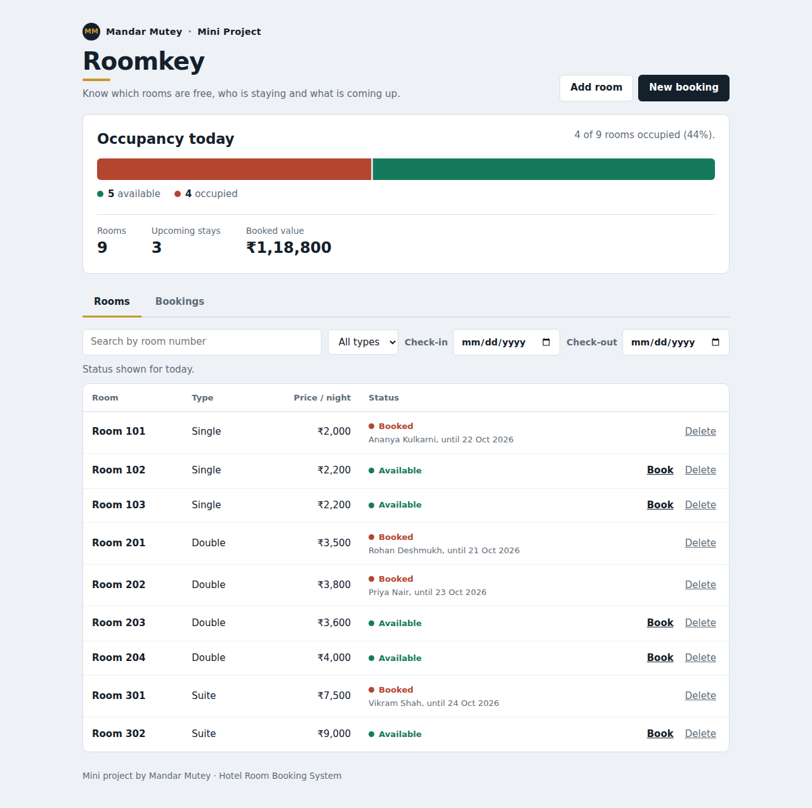
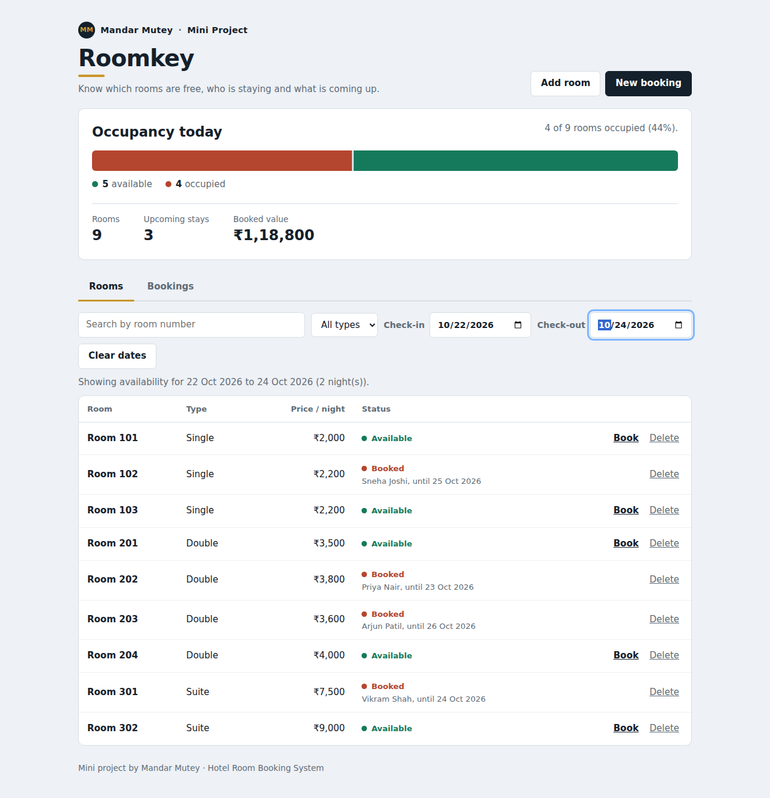
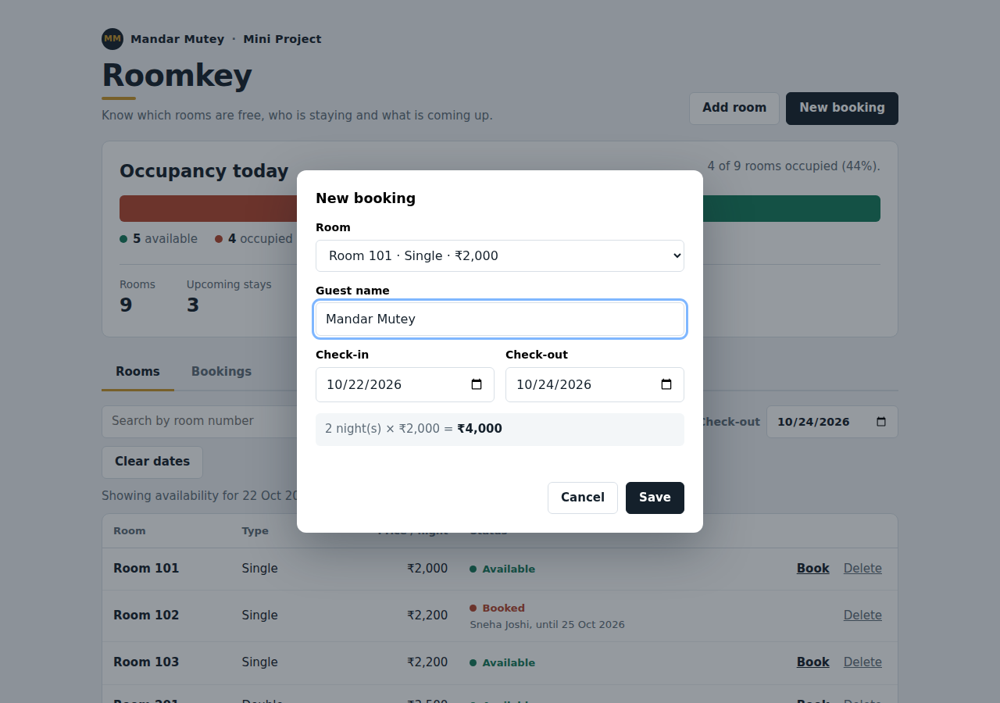
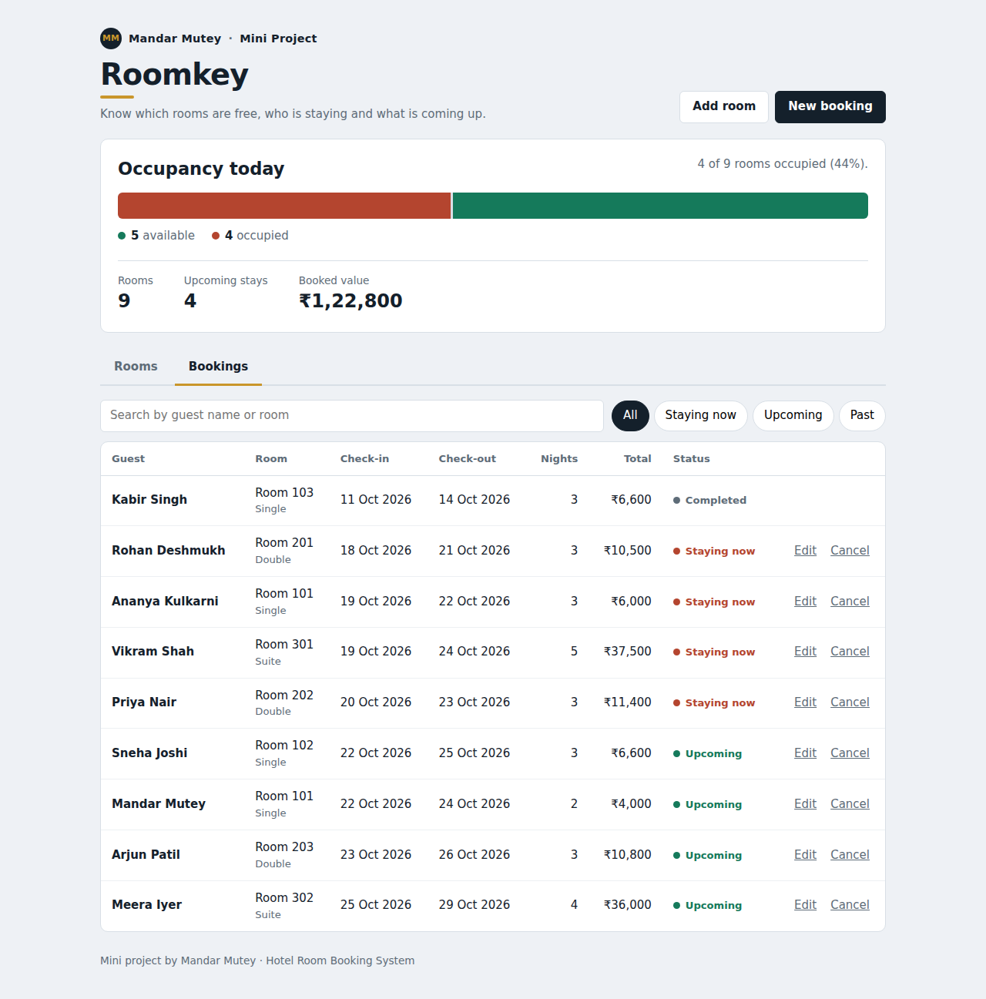
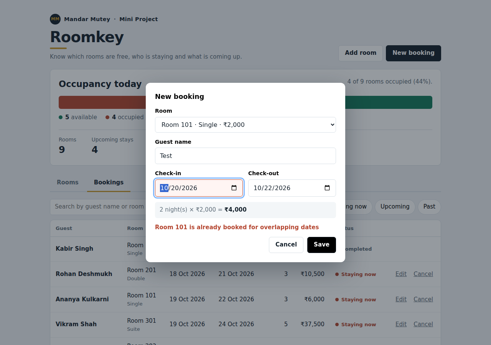

# Roomkey: Hotel Room Booking System

A mini full-stack hotel booking app built with **HTML, CSS, JavaScript, Node.js (Express) and SQLite**.



**Author:** Mandar Mutey | **Project:** Mini Project, Aim 1 (Hotel Room Booking System)

## Features

- Add, search, filter and delete rooms (room number, type, price per night)
- Check availability for any date range; available rooms get a one-click **Book** button
- Book rooms, edit booking dates, and cancel bookings, all without a page reload
- **Double-booking prevention:** overlapping dates for the same room are rejected (check-out day stays free for the next guest)
- Live occupancy bar, upcoming stays and booked value
- Bookings list with search and filters: staying now, upcoming, past
- Validation on client and server: no past check-in, check-out after check-in, unique room numbers, positive prices
- SQLite database and demo data are created automatically on first run (`SEED_DEMO=0` for an empty start)

## Screenshots

| Availability search | New booking | Bookings |
| --- | --- | --- |
|  |  |  |

Double-booking prevention in action:



## Tech stack

| Layer    | Technology                          |
| -------- | ----------------------------------- |
| Frontend | HTML, CSS, JavaScript (Fetch API)   |
| Backend  | Node.js 18+, Express (REST API)     |
| Database | SQLite (`rooms`, `bookings`)        |

## Run locally

```bash
npm install
npm start
```

Open http://localhost:3000

## API routes

| Method | Route | Purpose |
| ------ | ----- | ------- |
| GET | `/api/rooms?q=&type=&check_in=&check_out=` | List / search rooms (status for today or for the date range) |
| GET | `/api/rooms/available?type=&check_in=&check_out=` | Only the free rooms for a date range |
| POST | `/api/rooms` | Add a room |
| DELETE | `/api/rooms/:id` | Delete a room (and its bookings) |
| GET | `/api/bookings?q=&status=` | List bookings (`current`, `upcoming`, `past`) |
| POST | `/api/bookings` | Create a booking |
| PUT | `/api/bookings/:id` | Change dates or guest name |
| DELETE | `/api/bookings/:id` | Cancel a booking |
| GET | `/api/summary` | Occupancy and totals |

## Database

- `rooms(id, room_no UNIQUE, type, price)`
- `bookings(id, room_id → rooms ON DELETE CASCADE, guest_name, check_in, check_out, created_at)`

Two stays clash when `existing.check_in < new.check_out AND existing.check_out > new.check_in`. The check and the insert run in one SQLite transaction.

## Tests

```bash
npm test
```

28 edge-case tests: overlapping and back-to-back bookings, past dates, reversed dates, blank guest, unknown room or booking, duplicate room, negative price, clashing edits, search and filters, summary totals, cascade delete.

## Project structure

```
server.js          Express app, database schema, REST API
public/            index.html, style.css, app.js
test.js            Edge-case tests
docs/              Screenshots of the running app
package.json
```
